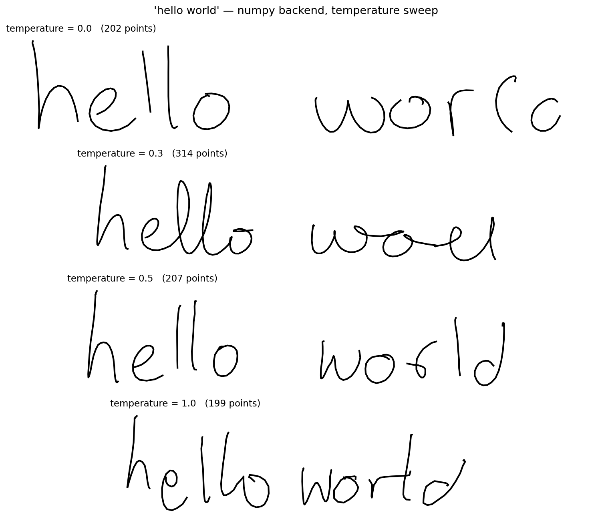
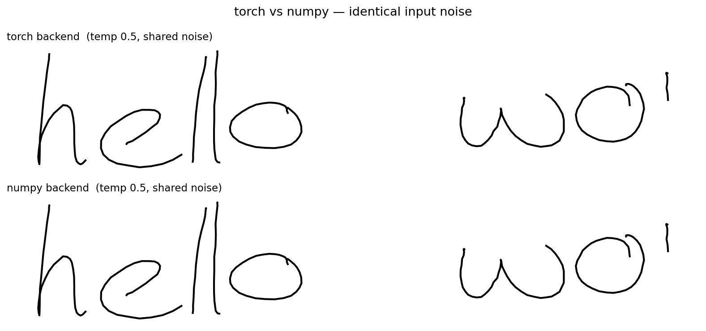

# Handwriting Synthesis

A from-scratch implementation of [Graves (2013) — *Generating Sequences With Recurrent Neural Networks*](https://arxiv.org/abs/1308.0850), trained on the IAM On-Line Handwriting Database and served as a streaming HTTP API.

You give it text. It generates realistic cursive handwriting, stroke by stroke.

---

## How it works

The model uses a **soft attention window** to align pen strokes with input characters. Three stacked LSTMs generate a mixture-density output (20 Gaussians) that models the joint distribution of pen offsets and pen-up events.

```
text: "hello world"
         ↓
   soft window (K=10 Gaussians along text axis)
         ↓
   3× stacked LSTM  (hidden size 400)
         ↓
   mixture density network (M=20)
         ↓
   pen strokes (dx, dy, pen_up)
```

The window is monotonic — κ only moves forward through the text — so the model can't cheat by re-reading characters.

---

## Samples

Temperature controls how "messy" the handwriting is (0 = deterministic, 1 = expressive).

| temp 0.0 | temp 0.3 | temp 0.5 | temp 1.0 |
|----------|----------|----------|----------|
| clean, rigid | slightly looser | natural | chaotic |



The numpy serving backend produces bit-for-bit identical output to the original PyTorch model:



---

## API

Live at: `https://handwriting-api-687921010800.europe-central2.run.app`

### Stream strokes (recommended)

```bash
curl -X POST https://handwriting-api-687921010800.europe-central2.run.app/generate/stream \
  -H "Content-Type: application/json" \
  -d '{"text": "hello world", "temperature": 0.5}'
```

Returns NDJSON — one `{"type": "point", "x": ..., "y": ..., "pen_up": 0|1}` per pen step, streamed live. Use this to animate the handwriting as it generates rather than waiting for the full result.

### JSON response

```bash
curl -X POST https://handwriting-api-687921010800.europe-central2.run.app/generate \
  -H "Content-Type: application/json" \
  -d '{"text": "hello world", "temperature": 0.5}'
```

### Other endpoints

| `GET /vocab` | list of drawable characters (77 total) |
|---|---|
| `GET /health` | liveness check + backend info |

Polish characters (ą, ę, ó, …) are automatically transliterated to ASCII. Anything else outside the vocab returns `400`.

---

## Architecture

| Component | Detail |
|---|---|
| Model | 3× LSTM, H=400, soft window K=10, MDN M=20 |
| Training | IAM On-Line Handwriting DB, 80 epochs, batch 80 |
| Checkpoint | `models/best-4.pth` is the base model. Other `.pth` files are experiments. |
| Serving | Pure numpy (no torch in production) |
| Deployment | Google Cloud Run, `europe-central2`, scale-to-zero |
| Image size | ~98 MB (vs ~334 MB with CPU torch) |
| Cold start | ~0.1–0.5s (numpy import; torch was 5–10s) |

The serving backend is a hand-ported numpy reimplementation of the forward pass (`model_np.py`), validated to < 2×10⁻⁵ absolute error against torch. This eliminates the `import torch` cold start entirely — the biggest user-perceptible latency was the import, not the generation.

---

## Running locally

```bash
# install deps (uv recommended)
uv sync

# generate a sample (torch)
uv run generate.py

# run the numpy API server
uv run app_np.py
# → http://127.0.0.1:5000

# generate a comparison grid
uv run python scripts/grid_samples.py
```

Weights live on Hugging Face ([PanzerBread/handwriting](https://huggingface.co/PanzerBread/handwriting)), not in this repo. Fetch them before running:

```bash
uv pip install "huggingface_hub[cli]"
hf download PanzerBread/handwriting weights.npz stoi.json std.json --local-dir .
```

### Training

```bash
# needs the IAM On-Line Handwriting Dataset in data/
uv run train.py
# saves checkpoints to models/post-trained.pth

# export for serving
uv run export_weights.py
# models/post-trained.pth → weights.npz + stoi.json
```

`models/best-4.pth` is the base model used for evaluation and for the post-training stages below. Checkpoints written by `train.py` are experiments.

### Post-training

Both stages keep `models/best-4.pth` as a frozen KL anchor and never write that file. The update is sequence-level REINFORCE on the stroke log-probability: length-normalized, with a per-prompt baseline, and a KL penalty back toward the base model. `train_rl.py` starts from `models/rl-trocr.pth` when that file exists, and from the base model otherwise. The recognizer loop is described in `docs/rl.md`.

**Recognizer reward.** TrOCR-Large reads a rendering of each sample. The default score has four parts: plain CER, the visual distance in `docs/vcer.md`, TrOCR confidence, and straightness. Plain CER is 60% of the score and vCER is 20%, so a lookalike costs less than a full edit and a real edit still costs more. There is no exact-match bonus. `--reward vcer` is the visual distance alone. `--reward cer` is plain CER alone. Those two still keep their exact-match term, then the same confidence and straightness. Word spacing is logged and is not part of the score.

| `--reward` | value |
|---|---|
| `both` (default) | `0.6 * (1 - min(CER, 1)) + 0.2 * (1 - min(wCER, 1)) + 0.2 * confidence - 0.05 * straightness`. Confidence never subtracts. `--confidence` is 0.2 and `--straightness` is 0.05. |
| `vcer` | `0.8 * (1 - min(wCER, 1)) + 0.2 * exact`, then the same confidence and straightness. |
| `cer` | `0.8 * (1 - min(CER, 1)) + 0.2 * exact`, then the same confidence and straightness. |
| `exp` | `exp(-CER)`, in (0, 1] |
| `linear` | `1 - CER` |
| `soft` | `1` when CER is at or below `--tau` (default 0.1), then a straight fall to 0 at CER = 1 |

A crooked line then loses a little more. The left quarter and the right quarter of the ink each have a band from the 10th to the 90th percentile. The score is how far the right band has moved from the left band, divided by the letter height, and the middle is compared with the ends the same way. A level line loses nothing. `--straightness` (default 0.05) is the most that penalty can subtract.

Word spacing is measured and shown in the sample table. It does not change the reward. `--spacing` defaults to 0.

Prompts default to `data/romeo_juliet.txt`, the whole play cut into lines of at most 48 characters and sampled at random. `--prompts data/sentences.txt` is the IAM pool. `--max-chars` defaults to 48 so TrOCR's square resize does not squash the line. On `--novel` of draws (default 0.05) the line is ten random words of at most 4 letters or digits from the model alphabet, such as `y142 OX7V Fz1M wsaY W5OF M3VV 8Zab c12d eF3g h4`. On `--words` of draws (default 0.10) the line is random lowercase dictionary words with no punctuation, filled until another word would pass `--max-chars`, so it is no longer than a play line. The rest of the draws stay on the file. `--novel 0` and `--words 0` turn each mix off. `--text` stays on that one sentence.

A play line is drawn from the full string, the same way the server draws it. `--beam` finished lines (default 16) share a copied pen state. Half of those lines use 4 roots that fork in 2, then in 2 again, every few hundred pen steps. The other half use 4×4, 2×8, or 16 separate drawings. `--tree 4x2x2` or `--tree 16` pins one of those. TrOCR scores the finished lines only. The value of a saved pen state is the mean score of the lines that grew from it. A chunk's advantage is how that value changed, spread over a few pen steps at the cut, and one update steps on every chunk together.

A dictionary line is a regression check: 4 to 8 separate drawings, on about 10% of updates (`--words`, `--easy-leaves`). A novel line is up to 64 separate drawings of the full string (`--novel` 0.05, `--novel-leaves`). The loop stops early when a read is exact, and that drawing is the demonstration. The other novel drawings keep the recognizer score, so a nearer miss ranks above a miss. One logged update is the whole line. The charts average the finished lines. Reward and CER can show the novel lines, the dictionary words, the play, or all of them; KL and steps stay on every update. `-k`, `--batch`, `--keep`, and `--factor` do not change this.

**Human preference.** The model draws 3 samples of one prompt. You pick the best. That sample scores 1 and the other two score 0.

```bash
uv sync --extra rl          # transformers, for the recognizer stage
uv run train_rl.py          # ~10 min of updates, then a checkpoint
                            # models/rl-trocr.pth is the latest; re-run resumes it
                            # samples/rl/ckpt-NNNN.png is 10 draws of one fixed sentence
                            # --ckpt samples/rl/ckpt-0003.pth continues from that one
uv run train_rlhf.py        # writes models/rl-human.pth, appends data/rlhf_prefs.jsonl
```

`train_rlhf.py` resumes from `models/rl-human.pth` if it exists, otherwise from `models/rl-trocr.pth`, otherwise from the base model. The KL anchor stays `models/best-4.pth`.

---

## Repo layout

```
model.py              # PyTorch model (training)
model_np.py           # numpy forward pass (serving)
app_np.py             # Flask API (deployed)
train.py              # supervised training loop
train_rl.py           # post-train on a TrOCR-Large CER reward
train_rlhf.py         # post-train on a human best-of-3 pick
rl.py                 # CER reward, trajectory log-prob, REINFORCE
generate.py           # sample from a checkpoint
export_weights.py     # .pth → weights.npz for serving
data.py               # dataset + dataloader
Dockerfile            # slim numpy image, no torch

models/               # checkpoints (gitignored)
  best-4.pth          #   base model, not overwritten by post-training
  rl-trocr.pth        #   recognizer-reward RL
  rl-human.pth        #   human best-of-3 RL

scripts/              # dev / demo tools
  grid_samples.py     #   sample grid across texts + temps
  generate_variants.py#   variant PNGs for video picking
  render_drawing_mp4.py#  animated MP4 from streamed inference
  import_collected.py #   canvas JSON → numpy
  export_dataset.py   #   merge sources → data/dataset.npz
  rebuild_dataset.py  #   rebuild with QA rejections
  iam_helper.py       #   review-tool helper

docs/                 # images, deployment notes, dev logs
```

---

## References

- Graves, A. (2013). [Generating Sequences With Recurrent Neural Networks](https://arxiv.org/abs/1308.0850)
- [IAM On-Line Handwriting Database](https://fki.tic.heia-fr.ch/databases/iam-on-line-handwriting-database)
